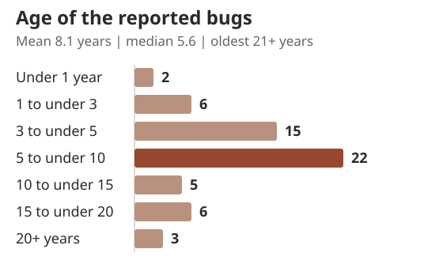

+++
title = "Lessons from 59 Linux Kernel Bug Reports"
date = 2026-11-11
description = "How Microsoft FORGE Lab used codename MDASH to investigate Linux kernel vulnerabilities, producing 59 upstream bug reports, 33 CVEs, and 38 merged fixes."
slug = "linux-kernel-3-month-lookback"
author = "Cen Zhang"
author_url = "https://cenzhang.github.io/"
toc = true
artwork = "kernel-repair"
aliases = ["/posts/linux-kernel-stage-one/"]
+++

At Microsoft's FORGE Lab, we used [codename MDASH](https://www.microsoft.com/en-us/security/blog/2026/05/12/defense-at-ai-speed-microsofts-new-multi-model-agentic-security-system-tops-leading-industry-benchmark/) to scan a subset of Linux kernel subsystems from late May to mid-June 2026. One full-time researcher and one intern led this three-month effort, which has so far produced [59 public upstream reports][upstream-reports] and [33 assigned CVEs](cves.txt). We confirmed working root privilege-escalation exploits for eight of those CVEs, and fixes for 38 of our reports have been merged into mainline.

Finding the bugs was only part of the work. The initial scans produced 26,502 raw findings in about two weeks, but turning those results into reproducible bugs, upstream reports, and patches took months of expert investigation and collaboration with Linux maintainers.

In this post, we look back at how we went from thousands of potential findings to validated vulnerabilities and upstream fixes, and what we learned about scaling vulnerability discovery with AI.

## From scans to reports

We focused on several core kernel subsystems, such as networking, filesystems, and security modules. Our selection criteria were straightforward: we picked security-sensitive components with no obvious dependence on specialized hardware, making QEMU-based validation simple and unified. Code scanning mainly used Sonnet 4.6 (71.1% of code-scanning tokens), GPT-5.4 (20.1%), and GPT-5.5 (7.1%).

The codename MDASH scans produced 26,502 raw scan findings in about two weeks on two servers (64 cores/256 GB RAM and 32 cores/128 GB RAM), but turning that output into patches and reports took months of expert work. We filtered out low-confidence claims using codename MDASH's confidence levels and separate fast screening agents we built, reducing the pool to 11,769 candidates. PoC-generating agents then attempted reproduction in QEMU, mainly using GPT-5.5 (77.3% of reproduction tokens), Opus 4.6 (13.2%), and GPT-5.5-cyber (9.4%). Experts then reviewed the 621 cases with PoC evidence to identify root causes, merge duplicates, and prepare upstream submissions.


#### Where the 621 cases went

Roughly one public upstream report landed from every ten PoC-backed cases: 59 reports from 621 cases (9.5%). Across those cases, the main reasons for not filing a separate new report were:

- **266 (42.8%)** shared a root cause with another case, so one patch could fix them together.
- **163 (26.2%)** were not reported after review, mostly due to limited security impact.
- **133 (21.4%)** were already reported or fixed upstream.

Submission timing explains many of the 133 overlaps. Most of the 621 cases were new when the scans finished (though some may already have been in flight by others). Our [first public report](https://lore.kernel.org/all/20260627024023.2201160-1-xmei5@asu.edi/) went out on June 27, 2026, more than five weeks after scanning started. By September 1, 55 of the 59 had been posted to the public lists; the other four were reported privately during the same window and routed to the public lists by mid-October.

#### Getting fixes merged

Upstream Linux typically requires vulnerability reports to come with a working patch. Agents helped draft initial fixes, but human validation, subsystem understanding, and iterating with maintainers during review remained essential. So far, fixes for 38 of our reports have been merged into upstream mainline—half on the first submission, and the rest after one to four revisions. Reaching a mainline release from the first public patch took a median of 41 days (up to 108 days), and we are still working with maintainers on the remaining reports.

#### How old the bugs were

Interestingly, most of the bugs we reported had been in the kernel for years. Across the 59 reports, the average bug was 8.1 years old when we first reported it publicly. One of the oldest, a [cls_u32 shift-out-of-bounds bug (CVE-2026-74544)](https://lore.kernel.org/all/20260720034514.23053-1-blbllhy@gmail.com/), had been there for at least 21 years.



## Selected findings

Among the 33 CVEs assigned so far from this batch, 24 are rated High or above (CVSS v3.1 score of at least 7.0). Below are eight CVEs for which we confirmed local root privilege-escalation exploits in controlled laboratory environments, with some cases requiring non-default settings or disabled exploit mitigations:

| CVE-2026-… | Module | Summary |
|---|---|---|
| [64554](https://www.cve.org/CVERecord?id=CVE-2026-64554) | `net/ipv6` | [**Use-after-free** in bridged IPv6 fragmentation: a saved pointer into a packet was reused after the packet's buffer was reallocated.](https://lore.kernel.org/all/20260706232850.3333016-1-xmei5@asu.edu/) |
| [64563](https://www.cve.org/CVERecord?id=CVE-2026-64563) | `lib/rhashtable` | [**Use-after-free** in hash-table walks: a walk resumed after the table was resized reused a pointer to a possibly freed entry.](https://lore.kernel.org/all/CAB8m9Wh559e+=n8z51gB8DrbEyCc2mc0MgGjrRR6_VXBmU=2AQ@mail.gmail.com/) |
| [64580](https://www.cve.org/CVERecord?id=CVE-2026-64580) | `net/ipv6` | [**Refcount underflow** in IPv6 IPsec routing: an error path dropped a device reference but kept the pointer, so cleanup dropped it again.](https://lore.kernel.org/all/20260702010516.221830-1-xmei5@asu.edu/) |
| [74561](https://www.cve.org/CVERecord?id=CVE-2026-74561) | `net/ipv4` | [**Use-after-free** in next-hop replacement: the route-cache flush walked an IPv6 route list without its lock, racing with route deletion.](https://lore.kernel.org/all/20260722002951.2614721-2-xmei5@asu.edu/) |
| [74562](https://www.cve.org/CVERecord?id=CVE-2026-74562) | `net/ipv4` | [**Use-after-free** in next-hop replacement: route checks and notifications walked an IPv6 route list without its lock, racing with route deletion.](https://lore.kernel.org/all/20260722002951.2614721-1-xmei5@asu.edu/) |
| [89789](https://www.cve.org/CVERecord?id=CVE-2026-89789) | `drivers/net` | [**Use-after-free** in the GTP tunnel driver: when device creation failed, its lookup tables were freed while incoming packets could still read them.](https://lore.kernel.org/all/20260819014858.76707-1-blbllhy@gmail.com/) |
| [98222](https://www.cve.org/CVERecord?id=CVE-2026-98222) | `security/keys` | [**Heap buffer overflow** in encrypted-key updates: long key parameters overflowed a 16-bit length, so the kernel wrote past an undersized buffer.](https://lore.kernel.org/all/20260826154456.85974-1-blbllhy@gmail.com/) |
| [98364](https://www.cve.org/CVERecord?id=CVE-2026-98364) | `net/xfrm` | [**Use-after-free** in IPsec routing: a network device was used without holding a reference, so deleting it at the same time could free it mid-use.](https://lore.kernel.org/all/20260820200245.44312-1-blbllhy@gmail.com/) |

### A closer look at CVE-2026-64563

[CVE-2026-64563](https://www.cve.org/CVERecord?id=CVE-2026-64563) is a one-line state-reset bug in `rhashtable`, the Linux kernel's shared resizable hash table. Because callers trust the object pointers returned by a table walk, this small library flaw enabled a stable local privilege escalation on Linux—and affected Android with SELinux enforcing—without requiring special kernel configurations or user namespaces.

Many kernel subsystems store live objects, such as [sockets](https://github.com/torvalds/linux/blob/dc59e4fea9d83f03bad6bddf3fa2e52491777482/net/netlink/af_netlink.h#L24-L52), in [`rhashtable`](https://github.com/torvalds/linux/blob/dc59e4fea9d83f03bad6bddf3fa2e52491777482/include/linux/rhashtable.h#L31-L65) and walk the table when user space asks to list them. Because a large listing may be split across several replies, a walk can pause and resume. Its [iterator](https://github.com/torvalds/linux/blob/dc59e4fea9d83f03bad6bddf3fa2e52491777482/include/linux/rhashtable-types.h#L129-L136) saves where it stopped, including a pointer to the last visited entry (`iter->p`). While the walk is paused, however, the table can still change: entries can be removed and freed, and resizing can replace the underlying bucket table.

#### The missed reset

Before 2018, [`rhashtable_walk_stop()`](https://github.com/torvalds/linux/blob/b41cc04b662ac96bbb291fb66b7b8aab5bc0a8c9/lib/rhashtable.c#L902-L925) always cleared `iter->p = NULL` on pause. To improve walk stability across `stop`/`start` cycles, a [2018 commit (`5d240a8936f6`)](https://github.com/torvalds/linux/commit/5d240a8936f6a1d3ece06701e8c4d830a2eca8a8) kept `iter->p` across `walk_stop()` and moved the reset into [`rhashtable_walk_start_check()`](https://github.com/torvalds/linux/blob/dc59e4fea9d83f03bad6bddf3fa2e52491777482/lib/rhashtable.c#L862-L922)—but only on one of its two resume paths:

- **Old table still present (`iter->walker.tbl != NULL`)**: [lines 884–919](https://github.com/torvalds/linux/blob/dc59e4fea9d83f03bad6bddf3fa2e52491777482/lib/rhashtable.c#L884-L919) scan the bucket chain for `iter->p` and reset `iter->p = NULL` if the entry was removed.
- **Old table freed by a resize (`iter->walker.tbl == NULL`)**: [lines 877–882](https://github.com/torvalds/linux/blob/dc59e4fea9d83f03bad6bddf3fa2e52491777482/lib/rhashtable.c#L877-L882) switch to the new table, reset `slot` and `skip`, and return `-EAGAIN` early without clearing `iter->p`:

```c
if (!iter->walker.tbl) {
	iter->walker.tbl = rht_dereference_rcu(ht->tbl, ht);
	iter->slot = 0;
	iter->skip = 0;
	return -EAGAIN;
}
```

After that restart, the next call to [`rhashtable_walk_next()`](https://github.com/torvalds/linux/blob/dc59e4fea9d83f03bad6bddf3fa2e52491777482/lib/rhashtable.c#L1007-L1035) sees `iter->p` still set and follows `iter->p->next` instead of starting over at `slot = 0`. If that entry was freed while the walk was paused, dereferencing `iter->p->next` reads from freed memory.

Why did this bug go unnoticed for eight years? Triggering it requires three conditions to line up in the same walk: the caller must pause and resume the same iterator across `walk_stop()` and `walk_start()`, a table resize must free the old bucket table during that pause, and the entry at `iter->p` must also be removed and freed before the walk resumes. Most `rhashtable` walkers finish in a single pass without ever resuming a stopped iterator, and even when a caller does pause and resume, those three events rarely coincide by accident in normal workloads.

The [upstream fix](https://github.com/torvalds/linux/commit/8173f7e2ce67e6ca1d4763f3da14e5b01ce77456) simply clears the stale pointer before returning:

```diff
+		iter->p = NULL;
```

#### From a socket listing to a kernel write

Because `rhashtable` is a shared library, its callers determine both whether this bug is reachable and how severe its security impact can be. Across the kernel, there are about two dozen files that use the `rhashtable` walker API, and most walk the table in a single pass and immediately exit. Among those callers, we found two that pause and resume an iterator across batches and can at least cause a crash: [TIPC's socket dump](https://github.com/torvalds/linux/blob/dc59e4fea9d83f03bad6bddf3fa2e52491777482/net/tipc/socket.c#L3555-L3588) (`tipc_nl_sk_walk()`) and [Netlink's socket diagnostics](https://github.com/torvalds/linux/blob/dc59e4fea9d83f03bad6bddf3fa2e52491777482/net/netlink/diag.c#L120-L147) (`__netlink_diag_dump()`).

Of the two, [`__netlink_diag_dump()`](https://github.com/torvalds/linux/blob/dc59e4fea9d83f03bad6bddf3fa2e52491777482/net/netlink/diag.c#L89-L152) is the exploitable caller. It is reachable by unprivileged users on standard kernels, and user space controls the pause between dump replies (via `recvmsg()`). An attacker can hold a dump paused while resizing the table and freeing the socket at `iter->p`, then reallocate that memory to control `iter->p->next`—causing [`rhashtable_walk_next()`](https://github.com/torvalds/linux/blob/dc59e4fea9d83f03bad6bddf3fa2e52491777482/lib/rhashtable.c#L1014-L1024) to return a fake socket pointer `sk`.

`__netlink_diag_dump()` then checks `net_eq(sock_net(sk), net)` and passes `sk` to [`sk_diag_fill()`](https://github.com/torvalds/linux/blob/dc59e4fea9d83f03bad6bddf3fa2e52491777482/net/netlink/diag.c#L57-L68) and [`sock_diag_save_cookie()`](https://github.com/torvalds/linux/blob/dc59e4fea9d83f03bad6bddf3fa2e52491777482/net/core/sock_diag.c#L26-L63), which initializes `sk->sk_cookie` if it is zero. That turns the fake `sk` pointer into a constrained 64-bit write (when the target 8 bytes are zero and `sk->sk_net` matches `&init_net`). Paired with other general exploitation techniques, this write is enough for local privilege escalation.

We thank Yuan Tan of NebuSec, who also independently found this vulnerability. He promptly shared its real severity with us and the maintainers, which helped the upstream fix, and later provided us with his working exploits for both Linux and Android. We also thank Frank Wu of NebuSec, who identified a viable exploitation primitive and developed a working privilege-escalation exploit.

## Closing thoughts

- **Finding bugs and fixing them are drastically out of balance.** Two weeks of codename MDASH scanning produced the initial findings, which we narrowed to 621 PoC-backed cases. But it took over four person-months to report 59 of them—and five months later, 38 fixes have been merged. For complex infrastructure like the Linux kernel, keeping humans in the loop is still necessary, making human effort the bottleneck. Both bug hunters and maintainers can be overwhelmed by the volume of real findings, so focusing on genuinely high-severity issues is essential.
- **More tokens may yield more bugs, but not a secure system.** We scanned only a small fraction of the kernel, and further tuning and more tokens could uncover substantially more bugs. But even after fixing all of them, is the system secure? At Microsoft FORGE Lab, we're using AI to expand the scope of vulnerability research, but our experience shows that discovery is only one part of the work. The more urgent problem is how to build practical security solutions that are operational, cumulative, and economically sensible.

These lessons also extend beyond our research. Through close collaboration with the engineering teams building codename MDASH, we're applying what we learn from real-world vulnerability discovery and validation to inform how these capabilities evolve. The goal is to bring advances in AI-powered security research into the hands of security teams, helping them identify and address critical vulnerabilities more effectively.

[upstream-reports]: https://lore.kernel.org/all/?q=mid%3A20261013051553.71887-1-cenzhang%40linux.microsoft.com+OR+mid%3A20261012215703.30592-1-cenzhang%40linux.microsoft.com+OR+mid%3A20260925024408.32143-1-cenzhang%40linux.microsoft.com+OR+mid%3A20260925015251.21168-1-cenzhang%40linux.microsoft.com+OR+mid%3A20260901183151.16648-1-cenzhang%40linux.microsoft.com+OR+mid%3A20260818164825.63967-1-blbllhy%40gmail.com+OR+mid%3A20260827051859.45511-1-blbllhy%40gmail.com+OR+mid%3A20260819145658.29872-1-blbllhy%40gmail.com+OR+mid%3A20260826154456.85974-1-blbllhy%40gmail.com+OR+mid%3A20260901182136.13745-1-cenzhang%40linux.microsoft.com+OR+mid%3A20260901180600.10394-1-cenzhang%40linux.microsoft.com+OR+mid%3A20260901175834.8557-1-cenzhang%40linux.microsoft.com+OR+mid%3A20260901174934.6275-1-cenzhang%40linux.microsoft.com+OR+mid%3A20260828041925.36758-1-blbllhy%40gmail.com+OR+mid%3A20260821182449.79785-2-blbllhy%40gmail.com+OR+mid%3A20260821182449.79785-3-blbllhy%40gmail.com+OR+mid%3A20260820200245.44312-1-blbllhy%40gmail.com+OR+mid%3A20260820010617.46851-1-blbllhy%40gmail.com+OR+mid%3A20260816035205.57966-1-blbllhy%40gmail.com+OR+mid%3A20260825052404.45665-3-blbllhy%40gmail.com+OR+mid%3A20260822045407.28983-1-blbllhy%40gmail.com+OR+mid%3A20260819014858.76707-1-blbllhy%40gmail.com+OR+mid%3A20260817013237.2797-1-blbllhy%40gmail.com+OR+mid%3A20260816173713.28998-1-blbllhy%40gmail.com+OR+mid%3A20260722193719.81157-1-blbllhy%40gmail.com+OR+mid%3A20260717210143.4734-1-blbllhy%40gmail.com+OR+mid%3A20260724164719.99563-1-blbllhy%40gmail.com+OR+mid%3A20260721143602.64677-1-blbllhy%40gmail.com+OR+mid%3A20260719232153.1405569-1-xmei5%40asu.edu+OR+mid%3A20260706212556.3199234-1-xmei5%40asu.edu+OR+mid%3A20260720204430.1886091-1-xmei5%40asu.edu+OR+mid%3A20260720223400.1939998-1-xmei5%40asu.edu+OR+mid%3A20260720034514.23053-1-blbllhy%40gmail.com+OR+mid%3A20260723000016.84091-1-blbllhy%40gmail.com+OR+mid%3A20260722223832.3524006-1-xmei5%40asu.edu+OR+mid%3A20260722004818.72310-1-blbllhy%40gmail.com+OR+mid%3A20260720155210.34229-1-blbllhy%40gmail.com+OR+mid%3A20260722002951.2614721-1-xmei5%40asu.edu+OR+mid%3A20260722002951.2614721-2-xmei5%40asu.edu+OR+mid%3A20260721232805.2451198-1-xmei5%40asu.edu+OR+mid%3A20260720214103.47732-1-blbllhy%40gmail.com+OR+mid%3A20260719221523.1336739-1-xmei5%40asu.edu+OR+mid%3A20260718183420.13301-1-blbllhy%40gmail.com+OR+mid%3ACAB8m9WgETt0AjmFwE%3DF-CKjGXsK6_WDv0%3DkbYRcC8-noo%2BamnA%40mail.gmail.com+OR+mid%3A20260713233230.3553593-1-xmei5%40asu.edu+OR+mid%3A20260713221551.3344650-1-xmei5%40asu.edu+OR+mid%3A20260713215510.3288580-1-xmei5%40asu.edu+OR+mid%3A20260711005955.1467140-1-xmei5%40asu.edu+OR+mid%3A20260710230724.942574-1-xmei5%40asu.edu+OR+mid%3A20260710014109.536177-1-xmei5%40asu.edu+OR+mid%3A20260709220501.395659-1-xmei5%40asu.edu+OR+mid%3A20260706232850.3333016-1-xmei5%40asu.edu+OR+mid%3A20260707203215.2752-1-blbllhy%40gmail.com+OR+mid%3ACAB8m9Wh559e%2B%3Dn8z51gB8DrbEyCc2mc0MgGjrRR6_VXBmU%3D2AQ%40mail.gmail.com+OR+mid%3A20260707015440.3420673-1-xmei5%40asu.edu+OR+mid%3A20260702185805.615241-1-xmei5%40asu.edu+OR+mid%3A20260702224519.800135-1-xmei5%40asu.edu+OR+mid%3A20260702010516.221830-1-xmei5%40asu.edu+OR+mid%3A20260627024023.2201160-1-xmei5%40asu.edi
