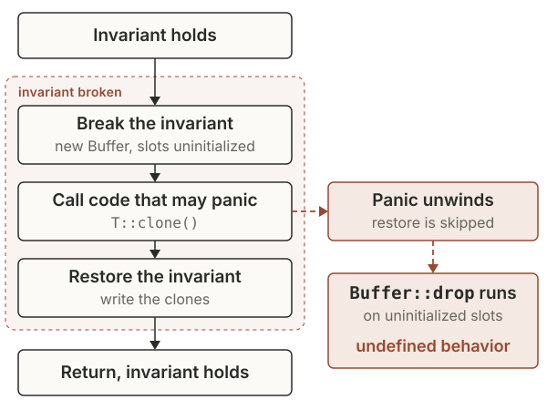

+++
title = "Memory Safety Bugs in Rust Standard Library"
date = 2026-11-09
description = "Knowing What You Trust: Three patterns behind memory safety bugs we found in Rust's standard library, and why Rust's safety model still matters even though it isn't perfect."
slug = "rust-std-memory-safety"
author = "Yechan Bae"
author_url = "https://github.com/qwaz"
toc = true
artwork = "rust-inspection"
+++

Microsoft's FORGE Lab found several memory-safety bugs in Rust's standard library (`std` and `core`), including cases where code written entirely in safe Rust can trigger undefined behavior. The findings reveal three recurring patterns of misplaced trust in unsafe code: trusting code not to panic, trusting user-provided implementations to be correct, and trusting the underlying system.

Rust's safety guarantees are precisely what make these findings interesting. Its rich type system and ownership model rule out whole classes of memory-safety issues, but much of the standard library relies on unsafe code underneath its safe APIs. When that code breaks its safety contract, even safe Rust can encounter behavior the language is designed to prevent.

That matters more as critical software moves to Rust.
Microsoft made Rust a
[Tier-1 internal language](https://rustfoundation.org/media/guest-post-rust-is-tier-1-language-at-microsoft/)
alongside C++, C#, and TypeScript, GitHub
[rewrote the Copilot agent runtime in Rust](https://github.blog/ai-and-ml/generative-ai/migrating-the-github-copilot-runtime-to-rust-using-copilot/),
and [Bun](https://bun.com/blog/bun-in-rust),
[Android](https://blog.google/security/rust-in-android-move-fast-fix-things/),
the [Linux kernel](https://lwn.net/Articles/1050174/), and
[Cloudflare](https://blog.cloudflare.com/20-percent-internet-upgrade/) are
moving code to it as well. Almost all of that code builds on the standard
library and relies on its safe APIs to keep their promises.

Unsafe Rust has been a long-running interest for us. Our team includes the
people behind [Rudra](https://dl.acm.org/doi/10.1145/3477132.3483570), a static
analyzer that looked for memory-safety bugs across the Rust ecosystem in 2021.
We also write many of our own tools in Rust, so its safety is more than a
research topic for us. This year, we took a closer look at the standard library
to see what kinds of mistakes still show up in its unsafe code today.

In this post, we share some of the bugs we reported to the Rust issue tracker.
We use them to discuss what Rust does and doesn't guarantee, why writing correct
unsafe Rust is so difficult, and why Rust's safety model still matters even
though its memory safety isn't perfect.

## How we found and validated the bugs

At [Microsoft FORGE Lab](https://www.microsoft.com/en-us/security/blog/2026/10/07/3-lessons-from-frontier-ai-vulnerability-research/), we study vulnerabilities in complex software, including the Rust standard library. Our team combines years of experience in vulnerability research with AI-assisted tools that help us investigate code and find bugs that are difficult to uncover through traditional analysis alone.

Some of the bugs in this post were found with help from Hyenas, our research version of [codename MDASH](https://www.microsoft.com/en-us/security/blog/2026/05/12/defense-at-ai-speed-microsofts-new-multi-model-agentic-security-system-tops-leading-industry-benchmark/). Our researchers investigated the underlying code, reproduced the bugs, assessed their potential security impact, and worked with Rust maintainers to report and fix them.

This post focuses on soundness bugs in the standard library's unsafe code. Bugs in the compiler itself, such as miscompilations and holes in the type system, are a different topic that we don't cover here.



**A note on open issues.** Some of the issues in this post are still open at the time of writing. The Rust
maintainers triaged and responded to our reports quickly, and we believe maintainers
and the contributors working on these issues are doing their best and making
the right tradeoffs among the many bugs they handle.

If you're interested in an open issue, please comment only when you have
something genuinely new to contribute, such as new information or an affected
real-world use case.



## Patterns of Rust's Safety Bugs

At the lowest level, Rust uses
[`unsafe` blocks](https://doc.rust-lang.org/book/ch20-01-unsafe-rust.html) to
work with raw pointers and interact directly with the operating system.
Much of the standard library, including `Vec` and `String`,
is built from small unsafe pieces wrapped in safe APIs.
Inside an `unsafe` block, the programmer takes responsibility for the guarantees
the compiler can't check, and that responsibility extends to the safe API built
around it. That API must be
[sound](https://doc.rust-lang.org/nomicon/safe-unsafe-meaning.html): no matter
how safe code uses it, it must be impossible to trigger undefined behavior.

Upholding that promise is harder than it looks. Consider a function that returns
the byte at `idx` from any type that can be viewed as a byte slice, skipping the
redundant bounds check after doing its own:

```rust
pub fn get<S: AsRef<[u8]>>(s: &S, idx: usize) -> Option<u8> {
    if idx < s.as_ref().len() {
        // SAFETY: we just checked that `idx` is in bounds.
        Some(unsafe { *s.as_ref().get_unchecked(idx) })
    } else {
        None
    }
}
```

The hard part of unsafe Rust is knowing what you can trust. The function above
looks correct, but it assumes that two calls to `as_ref` return the same slice.
Because `S` is chosen by the caller, a safe `AsRef`
implementation can return a long slice the first time and an empty one the
second, and `get` reads out of bounds. Unsafe code must be careful with every
call it makes, and the bugs we found fall into three patterns of misplaced
trust: trusting code not to panic, trusting user-provided implementations to be
correct, and trusting the underlying system.

### Pattern 1: Trusting code not to panic

Unsafe code often breaks an invariant for a moment and restores it afterward;
for example, it may allocate an uninitialized buffer and fill it directly,
avoiding redundant writes to zero the memory first. That's fine as long as the
function runs to the end. But many operations in Rust can panic,
from out-of-bounds indexing to calls into user-provided code, and by default a
panic unwinds: it leaves the function early while still running destructors.
Unwinding inside that window becomes an invisible exit that exposes the broken
invariant to code that trusts it. Bugs of this kind are called panic safety
bugs.



#### `MapWindows::clone` (#156501)

We identified
[a panic safety issue in `MapWindows::clone`](https://github.com/rust-lang/rust/issues/156501).
[`Iterator::map_windows`](https://doc.rust-lang.org/nightly/std/iter/trait.Iterator.html#method.map_windows),
a nightly API, yields overlapping windows of `N` items. It keeps the current
window in a `Buffer` whose destructor drops the `N` items starting at `start`.
In Rust 1.97.0,
[`library/core/src/iter/adapters/map_windows.rs`](https://github.com/rust-lang/rust/blob/1.97.0/library/core/src/iter/adapters/map_windows.rs#L37-L43)
defines it as:

```rust {linenos=inline,linenostart=37}
struct Buffer<T, const N: usize> {
    // Invariant: `self.buffer[self.start..self.start + N]` is initialized,
    // with all other elements being uninitialized. This also
    // implies that `self.start <= N`.
    buffer: [[MaybeUninit<T>; N]; 2],
    start: usize,
}
```

[`Buffer::clone`](https://github.com/rust-lang/rust/blob/1.97.0/library/core/src/iter/adapters/map_windows.rs#L195-L203),
in the same file, built the new buffer first and filled it afterward:

```rust {linenos=inline,linenostart=195}
impl<T: Clone, const N: usize> Clone for Buffer<T, N> {
    fn clone(&self) -> Self {
        let mut buffer = Buffer {
            buffer: [[const { MaybeUninit::uninit() }; N], [const { MaybeUninit::uninit() }; N]],
            start: self.start,
        };
        buffer.as_uninit_array_mut().write(self.as_array_ref().clone());
        buffer
    }
}
```

After line 197, `buffer` breaks its own invariant: its slots are uninitialized,
but its destructor is already armed. The `clone()` call on line 201 runs the
user's `T::clone` before the slots are written. If that call panics, unwinding
drops `buffer` and runs `drop_in_place` on `N` uninitialized values. Our proof of
concept uses only safe code: an element type whose `clone` always panics, which causes
a crash when the destructor accesses uninitialized memory. The
[fix](https://github.com/rust-lang/rust/commit/4a647a5084fa9100cb506185fa9ee9ed454374ab)
holds the new buffer in `ManuallyDrop` until it is fully written, so unwinding
leaks the half-built buffer instead of dropping it.

The general lesson is to treat every call to code you don't control, such as
`clone`, `drop`, comparisons, closures, and iterator methods, as a possible early
exit. Either finish the work that may panic before breaking an invariant, or
make the broken state safe to unwind through: hold it in `ManuallyDrop`, or use
a guard whose destructor restores the invariant, like `Vec`'s internal
`SetLenOnDrop`. The Rustonomicon covers this under
[exception safety](https://doc.rust-lang.org/nomicon/exception-safety.html).

#### Allocators must not unwind

The recently stabilized `Allocator` API shows how hard panic safety is to get
right. With `std`, an allocation failure
[aborts the process](https://doc.rust-lang.org/std/alloc/fn.handle_alloc_error.html)
by default instead of unwinding, so much of the standard library's unsafe code
assumes allocation never unwinds. Custom allocators can break that assumption.
While the API was being stabilized, we reported
[one place in `BTreeMap::insert`](https://github.com/rust-lang/rust/issues/156490)
that becomes unsound when an allocator unwinds, and others reported more
([#159334](https://github.com/rust-lang/rust/issues/159334),
[#159368](https://github.com/rust-lang/rust/issues/159368),
[#159370](https://github.com/rust-lang/rust/issues/159370)). Fixing them one by
one would mean auditing everything that allocates, so the
[stabilization](https://github.com/rust-lang/rust/pull/156882), shipping in
Rust 1.100 on November 12, instead requires implementors never to unwind from
the trait's methods or from `drop`. The proposal notes that "unwinding out of
many allocation-related methods was found to be a pervasive source of
unsoundness."

### Pattern 2: Trusting user-provided implementations to be correct

Unsafe code often calls into code its caller provides: a comparator, a trait
implementation, a closure. That code is safe, but safe doesn't mean correct, and
it can return inconsistent or plainly wrong answers. The question is who is
responsible when it does. In C++, it's the caller. `std::sort` requires its
comparator to be a strict weak ordering, and breaking that rule is undefined
behavior. With libstdc++, sorting equal elements with `<=` reads past the end of
the vector:

```cpp
std::vector<int> v(100, 42);
// Bug: `<=` is not a strict weak ordering, since cmp(a, a) is true.
std::sort(v.begin(), v.end(), [](int a, int b) { return a <= b; });
// AddressSanitizer: heap-buffer-overflow in std::__introsort_loop
```

The same comparator passed to Rust's
[`sort_by`](https://doc.rust-lang.org/std/primitive.slice.html#method.sort_by)
is only a logic error. The sort may panic or leave the slice in an unspecified
order, but it never causes undefined behavior. The responsibility sits with the
unsafe code. The comparator is safe code supplied by the caller, so the unsafe
code inside the sort must stay sound no matter what it returns. The same goes for every safe
trait a user can implement: comparisons can be inconsistent, an
`ExactSizeIterator` can report a length that doesn't match the items it yields,
and `Borrow` can return a different value on each call.

#### `str::replace` with a custom `Pattern` (#156491)

Another of our bug reports shows how easy this trust is to miss:
[`str::replace` with a custom `Pattern` can create a non-UTF-8 `String`](https://github.com/rust-lang/rust/issues/156491).
String search APIs accept any type that implements the nightly `Pattern` trait,
and a pattern can describe itself through `as_utf8_pattern`. `str::replace` uses
that description to take a fast path when replacing one ASCII byte with another.
In Rust 1.96.0, the fast path in
[`library/alloc/src/str.rs`](https://github.com/rust-lang/rust/blob/1.96.0/library/alloc/src/str.rs#L268-L278)
looked like this:

```rust {linenos=inline,linenostart=268}
pub fn replace<P: Pattern>(&self, from: P, to: &str) -> String {
    // Fast path for replacing a single ASCII character with another.
    if let Some(from_byte) = match from.as_utf8_pattern() {
        Some(Utf8Pattern::StringPattern([from_byte])) => Some(*from_byte),
        Some(Utf8Pattern::CharPattern(c)) => c.as_ascii().map(|ascii_char| ascii_char.to_u8()),
        _ => None,
    } {
        if let [to_byte] = to.as_bytes() {
            return unsafe { replace_ascii(self.as_bytes(), from_byte, *to_byte) };
        }
    }
```

[`replace_ascii`](https://github.com/rust-lang/rust/blob/1.96.0/library/alloc/src/str.rs#L708-L712),
in the same file, then rewrites the bytes:

```rust {linenos=inline,linenostart=708}
unsafe fn replace_ascii(utf8_bytes: &[u8], from: u8, to: u8) -> String {
    let result: Vec<u8> = utf8_bytes.iter().map(|b| if *b == from { to } else { *b }).collect();
    // SAFETY: We replaced ascii with ascii on valid utf8 strings.
    unsafe { String::from_utf8_unchecked(result) }
}
```

The `CharPattern` branch on line 272 checks that the character is ASCII, but the
`StringPattern` branch on line 271 assumes a one-byte string pattern must be
ASCII. That holds for `&str` patterns, but `StringPattern` stored `&[u8]`, and
`as_utf8_pattern` is a safe method any `Pattern` can implement. In our proof of
concept, a custom pattern reports the single byte `0x80`, which only appears
inside multibyte UTF-8 sequences:

```rust
impl Pattern for NonAsciiBytePattern {
    // ...
    fn as_utf8_pattern(&self) -> Option<Utf8Pattern<'_>> {
        static NEEDLE: [u8; 1] = [0x80];
        Some(Utf8Pattern::StringPattern(&NEEDLE))
    }
}

// "\u{d000}" is [ed, 80, 80]; the result is [ed, 3f, 3f], which is not UTF-8.
let corrupted = "\u{d000}".replace(NonAsciiBytePattern, "?");
```

`str::replace` rewrites the continuation bytes and returns a `String` that isn't
valid UTF-8, and later string operations that rely on UTF-8 reach undefined
behavior. The
[fix](https://github.com/rust-lang/rust/pull/156556) changed `StringPattern` to
hold `&str` instead of `&[u8]`, so the type itself now guarantees UTF-8.

When unsafe code depends on a property of a user-provided implementation, don't
take it on faith. Call the implementation once and keep the result, validate
what it returns, or encode the property in a type that safe code can't forge, as
this fix did. If none of those work, make the trait `unsafe` so implementors
explicitly promise to uphold it.

#### More examples

`join` shows how easy it is to fix this kind of bug only partway. In 2020, we
reported that it trusted `Borrow::borrow` to return the same string on each call
([CVE-2020-36323](https://rustsec.org/advisories/CVE-2020-36323.html)), and the
fix handled strings that shrink between calls. In April 2026, the same function
[needed another fix](https://github.com/rust-lang/rust/pull/155708): `join`
borrows the first element twice, and if it grows on the second call, the
remaining-length calculation underflows into a heap overflow. The earlier fix
had never covered that path.

Others reported similar problems in the `Pattern` API this year. A safe
`Pattern` can hand back a valid searcher built for a different string, and
consumers such as `strip_prefix_of` apply its ranges to the original string
unchecked, reading out of bounds
([#158265](https://github.com/rust-lang/rust/issues/158265)). The same problem
turned up in `split_once`
([#165076](https://github.com/rust-lang/rust/issues/165076)) after a report that
the `Searcher` contract doesn't spell out what `str::split` relies on
([#164904](https://github.com/rust-lang/rust/issues/164904)). Both bugs are
still open.

### Pattern 3: Trusting the underlying system

The first two patterns stay inside Rust code. The third sits at the boundary
with the operating system, where unsafe code trusts process-wide state such as
signal stacks, memory mappings, and the environment, which other threads, C
libraries, or the kernel can touch at any time. These bugs have been hard to
find automatically, because a static analyzer would need to model all of that
surrounding behavior. AI agents change the picture: they understand enough about
the environment the code runs in to make this area practical to search. We
started exploring it and found some interesting bugs.

#### `process::exit` and the main thread's signal stack (#161018)

When a thread overflows its stack, Rust prints a clear message and aborts
instead of crashing with a bare segmentation fault:

```text
thread 'main' (3307186) has overflowed its stack
fatal runtime error: stack overflow, aborting
```

This relies on a few pieces of process-wide state. Each thread's stack ends in a
guard page, an inaccessible region just past the stack's limit: `pthread`
reserves one for every spawned thread, and on Linux the kernel's own stack guard
plays that role for the main thread. Touching it raises `SIGSEGV`, and Rust
registers a handler for that signal. The handler can't run on the stack that just
overflowed, so Rust also gives each thread an alternate signal stack, a small
separate mapping with a guard page of its own, which the kernel switches to when
it delivers the signal. The handler checks that the faulting address is inside
the guard page, prints the message, and aborts.


[We found](https://github.com/rust-lang/rust/issues/161018) that calling
`process::exit` from a child thread tears down the main thread's alternate stack
while the main thread is still running. `process::exit` runs the runtime's
cleanup before calling libc's `exit`, and in Rust 1.98.0 that cleanup ends in
[`library/std/src/sys/pal/unix/stack_overflow.rs`](https://github.com/rust-lang/rust/blob/1.98.0/library/std/src/sys/pal/unix/stack_overflow.rs#L196-L203):

```rust {linenos=inline,linenostart=196}
pub unsafe fn cleanup() {
    if cfg!(panic = "immediate-abort") {
        return;
    }
    // FIXME: I probably cause more bugs than I'm worth!
    // see https://github.com/rust-lang/rust/issues/111272
    unsafe { drop_handler(MAIN_ALTSTACK.load(Ordering::Relaxed)) };
}
```

Line 202 passes `MAIN_ALTSTACK`, the main thread's alternate stack, to
[`drop_handler`](https://github.com/rust-lang/rust/blob/1.98.0/library/std/src/sys/pal/unix/stack_overflow.rs#L297-L301):

```rust {linenos=inline,linenostart=297}
// SAFETY: we warned the caller this disables the alternate signal stack!
unsafe { sigaltstack(&disabling_stack, ptr::null_mut()) };
// SAFETY: We know from `get_stackp` that the alternate stack we installed is part of
// a mapping that started one page earlier, so walk back a page and unmap from there.
unsafe { munmap(data.sub(page_size), sigstack_size + page_size) };
```

Line 298 disables the alternate stack of the calling thread, but line 301 unmaps
the main thread's. The code assumes it runs on the main thread, which isn't true
when a child thread calls `process::exit`. The main thread keeps running until
libc's `exit` finishes, with its signal stack registration still pointing at
unmapped memory. If it overflows its stack in that window, the kernel can't
deliver the signal, and our proof of concept dies with a plain segmentation
fault instead of Rust's message. The bug dates back to
[2015](https://github.com/rust-lang/rust/pull/28069), and the
[fix](https://github.com/rust-lang/rust/pull/161037) stops cleaning up the main
thread's alternate stack altogether.

We also checked whether this could become a security issue. In theory, it could
lead to code execution: if a writable mapping landed at the old alternate
stack's address, the kernel would deliver the main thread's next signal onto it,
and another thread could overwrite the handler's frame, such as its return
address, while it runs. In practice, the conditions are very tight. Everything
has to happen in the brief window before libc's `exit` finishes, the new mapping
must have exactly the right size to reuse that address, and overwriting the
frame takes a second race inside a short handler. We found no reliable way to
get a writable mapping of that size, so we judged it unlikely to be exploitable.
The [issue](https://github.com/rust-lang/rust/issues/161018) has more details in
its security impact analysis.

#### `CommandExt::exec` and the global environment (#156951)

[Our other report](https://github.com/rust-lang/rust/issues/156951) involves the
process environment. On Unix, `CommandExt::exec` replaces the current process
with a new program. When the command has its own environment variables, `exec`
points the process-global `environ` at a new array, calls `execvp`, and restores
`environ` if `execvp` fails. In Rust 1.99.0, `Command::exec` takes the
environment lock in
[`library/std/src/sys/process/unix/unix.rs`](https://github.com/rust-lang/rust/blob/1.99.0/library/std/src/sys/process/unix/unix.rs#L242-L244):

```rust {linenos=inline,linenostart=242}
let _lock = sys::env::env_read_lock();

let Err(e) = self.do_exec(theirs, envp.as_ref());
```

[`Command::do_exec`](https://github.com/rust-lang/rust/blob/1.99.0/library/std/src/sys/process/unix/unix.rs#L409-L414),
in the same file, then swaps the environment:

```rust {linenos=inline,linenostart=409}
    _reset = Some(Reset(*sys::env::environ()));
    *sys::env::environ() = envp.as_ptr();
}

libc::execvp(self.get_program_cstr().as_ptr(), self.get_argv().as_ptr());
Err(io::Error::last_os_error())
```

Line 242 takes only the read side of the environment lock, yet line 410 writes
the process-global `environ`; line 409 saves the old value so it can be restored
if `execvp` on line 413 fails. Writing `environ` under a read lock lets other
threads in. A thread calling `env::var` takes the same read lock and can see
variables meant only for the new program, and two failed `exec` calls racing
each other can leave `environ` pointing at a freed array that a later
`env::vars_os()` reads. Both proofs of concept use only safe Rust. A
[2018 fix](https://github.com/rust-lang/rust/pull/55939) held an exclusive lock
here, but when the environment lock became a
[read-write lock](https://github.com/rust-lang/rust/pull/81850) in 2021, `exec`
kept the read side. A fix that avoids touching `environ` by calling `execve`
directly is [in review](https://github.com/rust-lang/rust/pull/157144).

The environment has caused trouble before. After a
[discussion that began in 2015](https://github.com/rust-lang/rust/issues/27970),
the 2024 edition
[marked `env::set_var` as `unsafe`](https://doc.rust-lang.org/edition-guide/rust-2024/newly-unsafe-functions.html),
because C functions on most Unix platforms read the environment without going
through Rust's lock.

#### `process::exit` and thread-local destructors (#164243)

Getting this boundary right is hard, and more problems are still open. While
exploring this area, we independently ran into a double free in safe code that
`process::exit` can cause through thread-local destructors. It was reported by
someone else ([#164243](https://github.com/rust-lang/rust/issues/164243)), but
it's worth mentioning here. libc's `exit` first runs the calling thread's
thread-local destructors, as C++ requires, and Rust registers its destructors
the same way. If a destructor calls `process::exit` while a thread local is
being replaced, libc drops that thread local a second time. A
[proposed fix](https://github.com/rust-lang/rust/pull/165125) switches
`process::exit` to POSIX `_exit`, which ends the process without running these
handlers.

## Conclusion

Every unsafe block rests on assumptions about the code around it. The bugs in
this post came from three kinds of misplaced trust:

- that code won't panic at the wrong moment,
- that a caller-provided implementation behaves correctly, and
- that the process-wide state Rust shares with the operating system and the C
  library stays the way the code expects.

### Familiar patterns are still difficult (Patterns 1 and 2)

The first two patterns are well studied. [Rudra](https://dl.acm.org/doi/10.1145/3477132.3483570) looked for both in 2021, and the standard library was already fixing panic safety bugs in 2015 ([CVE-2015-20001](https://rustsec.org/advisories/CVE-2015-20001.html)). They remain challenging to avoid because any call inside unsafe code might unwind or run code the caller supplied.

What we saw this year was mixed. On the positive side, the nightly process is
working. Many reports were caught while the affected APIs were still unstable,
and several were fixed by changing the design before stabilization.
`StringPattern` now [holds `&str` instead of `&[u8]`](https://github.com/rust-lang/rust/pull/156556),
and `Allocator` was
[stabilized](https://github.com/rust-lang/rust/pull/156882) with a rule that
implementors must not unwind. At the same time, bugs in these patterns still
reach stable releases, and their fixes aren't always complete. `join` was fixed
in 2020 and
[needed another fix](https://github.com/rust-lang/rust/pull/155708) in 2026 for
a path the first fix had missed.

### System boundary bugs are now within reach (Pattern 3)

The third pattern is different. Its bugs live where Rust meets the layers below
it: the kernel, through system calls such as `sigaltstack` and `munmap`, and the
C library, through process-wide state such as `environ` and the cleanup that
libc's `exit` runs. Getting them right takes knowledge that lives outside
Rust's type system, which has made these bugs difficult to find with
traditional static analysis. That may also be why they last so long. The
`process::exit` signal stack bug was in the standard library for nearly 11
years, and `exec` has written `environ` under a read lock since 2021. Unlike our
reports in the first two patterns, both affect stable Rust.

Language models already know a great deal about how these interfaces behave, so
agentic scanners can check unsafe code against the system it runs on, not just
the language. We
think this boundary is one of the most promising places for agentic security
research, in Rust and beyond.

### Rust's high bar is hard to meet but worth keeping

Rust holds its safe APIs to a stricter standard than C and C++. Safe code must never be able to cause undefined behavior, no matter how it uses an API. In C++, a comparator that breaks `std::sort`'s ordering requirement causes undefined behavior, while Rust's `sort` must stay memory-safe with any `Ord` implementation. POSIX doesn't guarantee that `setenv` is safe to call while another thread reads the environment. That makes memory safety bugs in Rust hard to compare one-to-one with bugs in other languages.

For the same reason, a soundness bug in the standard library isn't automatically
a vulnerability in the programs that use it. Each bug in this post needs an
unusual setup to trigger, such as a panic at exactly the wrong moment, a
deliberately misbehaving implementation, or calling `process::exit` from a child
thread. It becomes a serious vulnerability only if a real program reaches the
API in that way.

Rust's safety standard is strict and difficult to meet, but it's also useful. It gives an unambiguous answer to what counts as a soundness bug, so problems can be fixed and prevented once in the library, instead of in every program that uses it. Rust's safety model strikes the right balance between control, safety, and performance for systems programming, which is why so many projects choose it.

## Beyond the lab

At Microsoft FORGE Lab, we're exploring how technology such as codename MDASH can help researchers find bugs like the ones in this post at greater scale. Rust's standard library is one of several foundational open source projects where we're applying this approach.

**This research also extends beyond the lab.** It helps inform the development of codename MDASH, which brings agentic vulnerability discovery into Microsoft Defender. These findings can also serve as inputs to Microsoft Perception, our new multi-agent security system, where specialized agents work together across broader security workflows. For example, the Web App Pen Test Agent can use codename MDASH findings to help prioritize testing, validate exploitability against live applications, and produce actionable vulnerabilities that downstream agents can use to prioritize and support remediation. This connects AI-powered code analysis with real-world security validation and response, helping security teams move from identifying potential vulnerabilities to understanding and addressing actual risk.

Our goal isn’t to simply find more bugs, it's to identify meaningful issues, turn those findings into actionable research, and improve the safety of foundational software that developers and organizations depend on.
